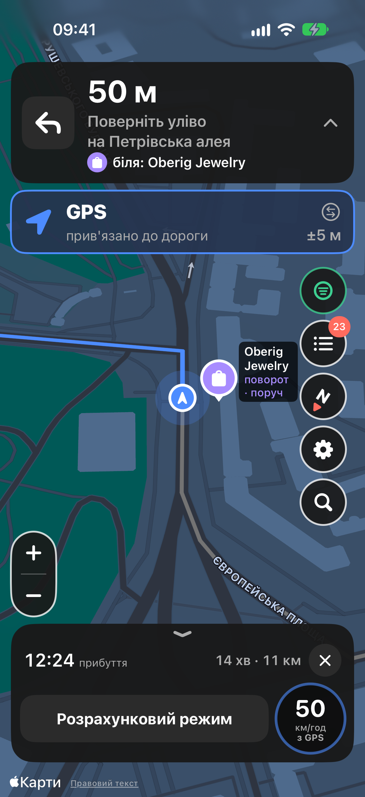
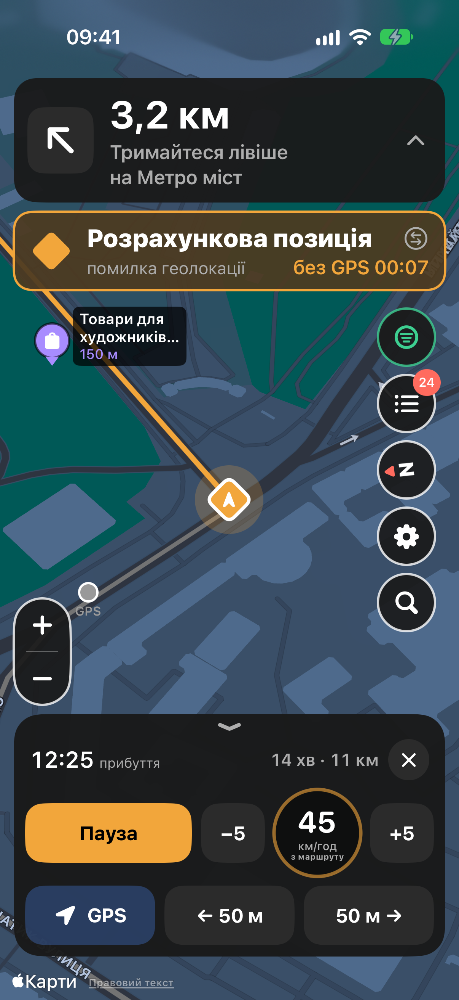
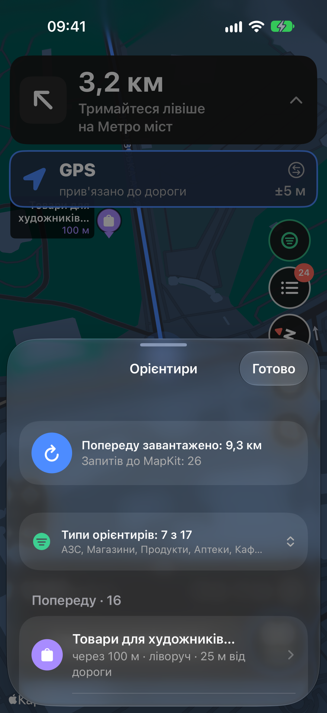

# Stone Nav

Навігатор для авто на iPhone, який веде до місця призначення навіть тоді, коли GPS зник або його підмінили (глушіння, спуфінг, тунелі, щільна забудова). Без GPS застосунок сам рухає вашу позицію по маршруту, а ви можете швидко її підправити: змінити швидкість, поставити паузу, зсунути точку вперед чи назад або вказати орієнтир, біля якого ви зараз.

* Карта, пошук і маршрути на Apple Maps: без ключів і реєстрацій.
* Голосові підказки українською, вони звучать і з вимкненим екраном, поверх музики.
* Маршрут зберігається на телефоні, тож далі навігація працює без інтернету.
* Орієнтири вздовж дороги (АЗС, аптеки, магазини тощо) допомагають зрозуміти, де ви зараз.

<p>
  
  
  
</p>

Сайт проєкту: **[foxfollow.github.io/stone-navigation-emulation](https://foxfollow.github.io/stone-navigation-emulation/)**.

Застосунку немає в App Store. Його ставлять на свій телефон самі, через Mac. Нижче покроково, як це зробити без досвіду програмування.

## Як поставити собі на iPhone

### Що потрібно

* **Mac** з macOS, на якій працює Xcode 27.
* **iPhone з iOS 27** або новішою і кабель, щоб підключити його до Mac.
* **Apple ID** (той самий, що в App Store). Платний акаунт розробника не потрібен.
* Близько 15 ГБ вільного місця на Mac для Xcode і близько години часу на перший раз.

### 1. Встановіть Xcode

Відкрийте App Store на Mac, знайдіть **Xcode** і встановіть. Після встановлення запустіть його один раз: він попросить доставити компоненти, погодьтеся. Якщо запитає, які платформи додати, виберіть **iOS**.

### 2. Додайте свій Apple ID у Xcode

Xcode → **Settings** (⌘,) → вкладка **Accounts** → «+» внизу ліворуч → **Apple ID** → увійдіть.

### 3. Завантажте код

На сторінці цього репозиторію на GitHub натисніть зелену кнопку **Code** → **Download ZIP**. Розпакуйте архів (подвійний клік), наприклад у папку «Завантаження».

### 4. Створіть проєкт Xcode

Файл проєкту генерує невелика програма XcodeGen. Відкрийте **Термінал** (Launchpad → Інше → Термінал, або ⌘Пробіл і введіть «Термінал») і виконуйте команди по одній: скопіюйте, вставте, натисніть Enter.

1. Встановіть Homebrew, менеджер програм для Mac (якщо його ще немає). Він попросить пароль від Mac, символи при введенні не видно, це нормально:
   ```sh
   /bin/bash -c "$(curl -fsSL https://raw.githubusercontent.com/Homebrew/install/HEAD/install.sh)"
   ```
   Наприкінці Homebrew може показати розділ **Next steps** з двома-трьома командами. Виконайте їх так само.
2. Встановіть XcodeGen:
   ```sh
   brew install xcodegen
   ```
3. Перейдіть у папку проєкту. Наберіть `cd ` (з пробілом наприкінці), потім перетягніть у вікно Термінала папку **StoneNavigationEmulation**, що лежить усередині розпакованого архіву, і натисніть Enter.
4. Створіть і відкрийте проєкт:
   ```sh
   xcodegen generate && open StoneNavigationEmulation.xcodeproj
   ```

### 5. Підпишіть застосунок своїм Apple ID

У Xcode, що відкрився:

1. Ліворуч угорі клацніть синю іконку **StoneNavigationEmulation**.
2. У списку **TARGETS** виберіть **StoneNavigationEmulation**, далі вкладка **Signing & Capabilities**.
3. **Team**: виберіть своє ім'я з позначкою «(Personal Team)».
4. **Bundle Identifier**: замініть `com.example` на щось своє латиницею, наприклад `com.ivanpetrenko.StoneNavigationEmulation`. Назва має бути унікальною у світі, тож пробуйте інші варіанти, якщо Xcode скаржиться.

Червоні помилки під Team мають зникнути.

### 6. Підготуйте iPhone

1. Підключіть iPhone кабелем до Mac, розблокуйте його і натисніть **«Довіряти»** на запит про комп'ютер.
2. Увімкніть **Режим розробника**: Параметри → Приватність і безпека → Режим розробника → увімкнути. Телефон перезавантажиться, після цього підтвердіть увімкнення.
   Якщо пункту «Режим розробника» немає, він з'явиться після того, як iPhone один раз побачить Xcode (крок 7), тоді поверніться сюди.

### 7. Запустіть

1. У Xcode вгорі посередині є список пристроїв. Виберіть у ньому свій iPhone.
2. Натисніть ▶ (або ⌘R). Перша збірка триває кілька хвилин.
3. Якщо iPhone пише **«Ненадійний розробник»**: Параметри → Загальні → VPN і керування пристроями → ваш Apple ID → **Довіряти**. Потім знову ▶ у Xcode або просто відкрийте застосунок на телефоні.

Застосунок **Stone Nav** з'явиться на екрані телефона. Далі Mac для поїздок не потрібен.

### 8. Перше налаштування на телефоні

* **Геолокація:** коли iOS запитає, дозвольте, а потім виберіть **«Завжди»**. Інакше навігація не працюватиме з вимкненим екраном.
* **Рух і фітнес:** дозвольте. Так застосунок помічає стоянку й повороти без GPS.
* **Український голос:** якщо в Налаштуваннях застосунку написано, що голосу немає: Параметри iPhone → Універсальний доступ → Вміст, що озвучується → Голоси → Українська → завантажити.

## Важливо: підпис діє 7 днів

З безкоштовним Apple ID Apple дозволяє такому застосунку працювати лише 7 днів. Потім він перестає відкриватися. Щоб продовжити, підключіть iPhone до Mac, відкрийте проєкт у Xcode (`StoneNavigationEmulation.xcodeproj` у тій самій папці) і знову натисніть ▶. Налаштування, збережені адреси й останній маршрут при цьому зберігаються.

З платним акаунтом Apple Developer Program (99 USD на рік) підпис діє рік. Тоді можна роздавати застосунок і через TestFlight.

## Якщо щось не так

* **Xcode пише «Couldn't load project "NavigationCore"» або «Missing package product»:** закрийте Xcode повністю (⌘Q) і відкрийте проєкт знову.
* **«Failed to register bundle identifier» або «No profiles for …»:** такий Bundle Identifier уже зайнятий. Змініть його (крок 5).
* **«Developer Mode disabled»:** крок 6.2.
* **Ви завантажили новішу версію коду:** повторіть кроки 4.3–4.4 і 5 для нової папки.

## Для розробників

* Проєкт генерує XcodeGen з `StoneNavigationEmulation/project.yml`, `.xcodeproj` у git немає.
* Team ID і префікс bundle ID задаються в `StoneNavigationEmulation/Config/Local.xcconfig` (не в git), щоб не вибирати їх у Xcode після кожного `xcodegen generate`:
  ```sh
  cp StoneNavigationEmulation/Config/Local.xcconfig.example StoneNavigationEmulation/Config/Local.xcconfig
  ```
* Логіка навігації в Swift-пакеті `NavigationCore` і тестується без симулятора: `cd StoneNavigationEmulation/NavigationCore && swift test`.
* Докладніше: [архітектура](docs/ARCHITECTURE.md), [специфікація](docs/SPEC.md), [звіт про тестування](docs/TEST_REPORT.md), [перевірка на телефоні та в авто](docs/DEVICE_CHECKLIST.md).

## Ліцензія

[MIT](LICENSE): код можна вільно використовувати, змінювати й поширювати, зберігши повідомлення про авторство.
